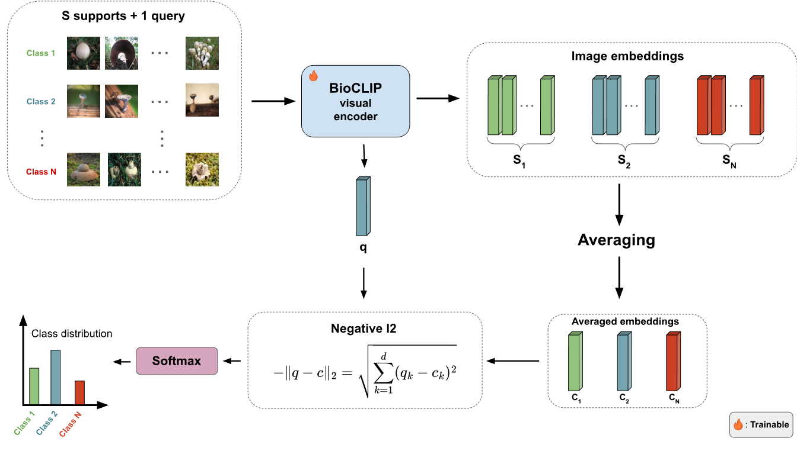

# Prototype-Network-FungiCLEF25


This is the official code repository of the paper: Improving Fungi Prototype Representations for Few-Shot
Classification published at FungiCLEF25 @ CVPR-FGVC & LifeCLEF

Paper: https://www.arxiv.org/abs/2509.11020

## Setup

```bash
pip install -r requirements.txt
```

Download the FungiCLEF 2025 data (FungiTastic-FewShot) so that `DATA` contains:

```
DATA/images/FungiTastic-FewShot/{train,val,test}/fullsize/*.JPG
DATA/metadata/FungiTastic-FewShot/FungiTastic-FewShot-{Train,Val,Test}.csv
```

Every command writes a `submission.csv` (top-5 `category_id` per test observation) for the
competition leaderboard. Run everything from the repository root.

## 4.1 Prototype averaging (Table 1)

No training. Class prototype = mean of the L2-normalised image embeddings, test observations ranked
by cosine similarity. `--support trainval` uses train and validation images (the reported setting).

```bash
python -m baseline.prototype_averaging --data-root DATA --model bioclip        # 0.6017 / 0.5472
python -m baseline.prototype_averaging --data-root DATA --model vit-h-14-dfn5b # 0.5221 / 0.4928
python -m baseline.prototype_averaging --data-root DATA --model vit-b-16-dfn2b # 0.4690 / 0.4463
```

## 4.2 CLIP finetuning with captions (Table 2)

The captions used in the paper are released in `data/captions/`:

| file | source |
|---|---|
| `gpt41_{train,val}.csv` | GPT-4.1-2025-04-14 |
| `qwen2vl_{train,val}.csv` | Qwen2-VL-2B finetuned on the GPT-4.1 captions |

Finetune ViT-H-14-378-quickgelu (DFN-5B) on them, then evaluate with prototype averaging:

```bash
bash clip_finetune/finetune.sh DATA gpt41      # 0.54424 / 0.48382
bash clip_finetune/finetune.sh DATA qwen2vl    # 0.41150 / 0.36093
python -m baseline.prototype_averaging --data-root DATA --model vit-h-14-dfn5b \
    --checkpoint logs/clip-gpt41/checkpoints/epoch_latest.pt
```

<details>
<summary>Regenerating the captions (needs an OpenAI key and a GPU)</summary>

GPT-4.1 captions. Train images: Molmo-7B drafts a caption from image + metadata, GPT-4.1 removes
inaccurate content and rewrites it, then GPT-4.1 shortens it to at most 70 tokens of visual
description (CLIP's text encoder is capped at 77 tokens). Validation images skip the Molmo draft.

```bash
python -m captions.molmo_caption --data-root DATA --out data/captions/molmo_train.csv
python -m captions.gpt_batch build   --stage correct --split train --data-root DATA --drafts data/captions/molmo_train.csv
python -m captions.gpt_batch build   --stage correct --split val   --data-root DATA
python -m captions.gpt_batch submit  --stage correct --split train   # same for val
python -m captions.gpt_batch collect --stage correct --split train   # -> data/captions/long_train.csv
python -m captions.gpt_batch build   --stage summarize --split train --data-root DATA --drafts data/captions/long_train.csv
python -m captions.gpt_batch submit  --stage summarize --split train
python -m captions.gpt_batch collect --stage summarize --split train # -> data/captions/gpt41_train.csv
```

Qwen2-VL-2B captions: 4-bit LoRA SFT (rank 8, alpha 16, dropout 0.05) on the GPT-4.1 captions,
then caption every image.

```bash
bash captions/qwen_sft.sh DATA
python -m captions.qwen_caption --data-root DATA --adapter logs/qwen2vl-fungi --split train
python -m captions.qwen_caption --data-root DATA --adapter logs/qwen2vl-fungi --split val
```
</details>

## 4.3 Prototypical networks (Table 3)

Episodic training of the image encoder: K classes per episode, S=3 support and Q=1 query image
per class, negative squared L2 logits, cross-entropy, AdamW lr 1e-5, SWA (lr 5e-5) over the last
100 episodes. At inference, prototypes are built from train and validation images and test
observations are ranked by cosine similarity.

```bash
# best: BioCLIP, train/val, K=75, 750 episodes          -> 0.64159 / 0.58473
python -m protonet.train --data-root DATA --encoder bioclip --split trainval --k 75 --episodes 750 --out bioclip_k75.pt
# BioCLIP, train, K=70, 500 episodes                    -> 0.61061 / 0.57179
python -m protonet.train --data-root DATA --encoder bioclip --split train --k 70 --episodes 500 --out bioclip_k70.pt
# ViT-B-16-SigLIP-512 (512x512 input), train, K=15, 750 -> 0.53539 / 0.53298
python -m protonet.train --data-root DATA --encoder siglip-512 --split train --k 15 --episodes 750 --out siglip_k15.pt

python -m protonet.predict --data-root DATA --encoder bioclip --weights bioclip_k75.pt
```

Implementation details not spelled out in the paper:

- One "episode" is one optimiser step whose gradient is accumulated over 32 sampled episodes
  (`--accum 32`), so the 750-episode run samples 24,000 episodes.
- Images are resized with bicubic interpolation, normalised with the CLIP mean/std, and randomly
  flipped/rotated by multiples of 90 degrees (`A.D4`); the same transform is applied when building
  prototypes and embedding test images.
- Classes with fewer than S images sample their support images with replacement.

## Figure 3

```bash
python -m protonet.predict --data-root DATA --weights bioclip_k75.pt --save-prototypes prototypes.pt
python -m analysis.umap_prototypes prototypes.pt
```

## Citation

```bibtex
@inproceedings{traore2025fungiprototypes,
  title     = {Improving Fungi Prototype Representations for Few-Shot Classification},
  author    = {Traore, Abdarahmane and Hervet, {\'E}ric and Couturier, Andy},
  booktitle = {Working Notes of CLEF 2025 - Conference and Labs of the Evaluation Forum},
  series    = {CEUR Workshop Proceedings},
  volume    = {4038},
  year      = {2025}
}
```
